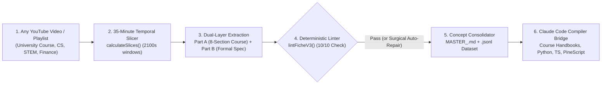

# YouTube Video Extractor (`v4.0.0`)

### Universal Video-to-Course, Formal Specification, AI Dataset & Code Compiler

[](https://github.com/Christ-yavn/youtube-video-extractor/actions/workflows/ci.yml)
[](./LICENSE)
[](./package.json)
[](./scripts/claude_agent_bridge.py)
[](./src/utils/pipeline.test.ts)

> **Turn any educational YouTube video, university lecture playlist, or technical channel into structured 8-section study handbooks, consolidated Master Concept Bibles (`MASTER_<CONCEPT>.md`), verified `.jsonl` AI training datasets, and working Python / TypeScript code via Anthropic's Claude Code.**

---

## Table of Contents

1. [Why This Project Exists (In Plain Words)](#1-why-this-project-exists-in-plain-words)
2. [What the Application Concretely Does (Step by Step)](#2-what-the-application-concretely-does-step-by-step)
3. [The 4 Universal Domain Profiles](#3-the-4-universal-domain-profiles)
4. [Inside the 10-Criteria Deterministic Linter (`lintFicheV3`)](#4-inside-the-10-criteria-deterministic-linter-lintfichev3)
5. [Compiling Knowledge with Anthropic's Claude Code](#5-compiling-knowledge-with-anthropics-claude-code)
6. [Benchmark Test #1: Why We Included a 106-Video Stress Test](#6-benchmark-test-1-why-we-included-a-106-video-stress-test)
7. [Bring Your Own Keys (BYOK), Privacy & Local Mode](#7-bring-your-own-keys-byok-privacy--local-mode)
8. [Installation & Complete Walkthrough (Web Studio & CLI)](#8-installation--complete-walkthrough-web-studio--cli)
9. [Repository Structure](#9-repository-structure)
10. [Companion Project: `quant-pod`](#10-companion-project-quant-pod)
11. [Présentation en Français](#11-présentation-en-français)

---

## 1. Why This Project Exists (In Plain Words)

For students, self-taught developers, and researchers around the world, YouTube has become the largest free university on earth. Thousands of hours of computer science courses, software architecture tutorials, mathematics lectures, and quantitative finance seminars are published there every week.

However, actually studying or building software from long YouTube videos is frustrating because **standard AI video summarizers fail in three predictable ways**:

1. **Transcripts miss what is shown on screen**: In a real lecture or coding tutorial, the speaker says *"look at how this node transitions here"* while pointing at a slide, code editor, whiteboard, or chart. Relying on audio transcripts alone strips away the visual structure of the lesson.
2. **Long videos lose detail in the middle**: When you feed a 90-minute or 2-hour video into an AI model in one shot, it summarizes the first 10 minutes and the conclusion well, but compresses or skips the crucial derivations and examples in the middle.
3. **Vague summaries cannot be studied or turned into code**: Most tools give you a short bulleted summary full of vague phrases like *"the author explains various parameters and edge cases."* You cannot revise for an exam from that, and an AI coding agent like **Claude Code** cannot compile vague prose into working, bug-free software.

**YouTube Video Extractor (`v4.0`)** was built from the ground up to solve all three problems. Instead of generating shallow summaries, it treats educational and technical videos as **source code to be extracted, verified, consolidated, and compiled**.

---

## 2. What the Application Concretely Does (Step by Step)

Whether you use the interactive **Web Studio** (`npm run dev`) or the **Command-Line Interface** (`scripts/universal_youtube_ingest.py`), every video or playlist goes through a 6-stage pipeline:



### Step 1 — Paste Any YouTube Video or Playlist
On the Home screen (**Universal YouTube Ingest Studio**), you paste any YouTube URL (`https://www.youtube.com/watch?v=...` or `youtu.be/...`), select one of the **4 Universal Domain Profiles**, and click **Add & Analyze**. The backend automatically fetches the video metadata (`oembed`) and prepares the extraction pipeline.

### Step 2 — Automatic 35-Minute Temporal Slicing & Deduplication
If a lecture is longer than **35 minutes (`2,100 seconds`)**, the function `calculateSlices()` in `src/utils/pipeline.ts` automatically divides the video into sequential 35-minute windows (`_S01`, `_S02`, `_S03`, ...).
- Each window is analyzed sequentially so the multimodal model never loses focus in the middle of a 2-hour lecture.
- If you import an entire channel where the same video appears in multiple playlists, `deduplicateVideos()` merges the duplicates while remembering every playlist the video belongs to.

### Step 3 — Dual-Layer Extraction (Human Course + Machine Specification)
For every video, the extractor generates a rich Markdown document divided into two complementary parts:

- **Part A — The 8-Section Human Course Handbook** (designed for students and human readers):
  1. **Pedagogical Objective & Prerequisites**: What the video teaches and what you need to know before watching.
  2. **Visual Intuition & Mental Models**: Plain-language explanation of the diagrams, slides, or charts shown on screen, anchored to exact `[MM:SS]` video timestamps.
  3. **Formal Definitions & Core Axioms**: Every key term defined without ambiguity.
  4. **Step-by-Step Worked Examples**: Detailed walkthroughs of the concrete examples demonstrated in the video.
  5. **Common Mistakes, Counter-Examples & Edge Cases**: Traps beginners fall into and specific conditions where a rule does *not* apply.
  6. **Operational Checklist & Decision Tree**: A practical step-by-step checklist to apply the concept in practice.
  7. **Cross-Video Synthesis & Curriculum Links**: How this lesson connects to prerequisite and advanced topics across the channel.
  8. **Self-Assessment Quiz & Active-Recall Flashcards**: Ready-to-use questions and answers to test comprehension.

- **Part B — The Formal Machine Specification** (designed for deterministic verification and code generation):
  - **Explicit Parameters (`[P-01]..[P-nn]`) & Design Decisions (`[D-01]..[D-nn]`)**: Every threshold, input type, and configuration choice extracted into structured tables.
  - **Testable Rules (`[R-01]..[R-nn]`) & Rejection Guards (`[REJ-01]..[REJ-nn]`)**: Explicit `IF ... THEN ...` conditions and invalidation rules.
  - **Dual Finite State Machines (`PRIMARY_FSM` × `SECONDARY_FSM`)**: Complete state-transition tables modeling how a concept or system moves from initial state to completion or failure.
  - **3 Executable JSON Verification Fixtures**: Three self-contained test cases (a normal valid case, an invalid/rejected case, and a boundary edge case) used to automatically test generated code.

### Step 4 — Automatic Quality Control via `lintFicheV3` (10 Criteria)
Before a video sheet is marked as `VALIDATED`, it is inspected by `lintFicheV3()` (`src/utils/ficheLinter.ts` & `src/utils/pipeline.ts`). If the AI left out a section, wrote a vague placeholder like `TODO`, or cited a timestamp that exceeds the video's duration, the linter flags the exact missing criteria and triggers a targeted repair pass so only complete specifications enter your knowledge base.

### Step 5 — Multi-Video Consolidation (`MASTER_<CONCEPT>.md`) & `.jsonl` Dataset Export
When a creator or professor explains a subject across 10, 30, or 100 videos, `conceptConsolidatorService.ts` groups all validated video sheets by concept and synthesizes a single **Master Concept Bible (`MASTER_<CONCEPT>.md`)**:
- It resolves terminology differences between older introductory videos and newer advanced videos.
- It preserves exact `[MM:SS]` citations back to every source video.
- With one click, `generateTrainingDatasetJsonl()` exports the entire knowledge base as a structured **`.jsonl` instruction-tuning and RAG dataset** ready for training or grounding LLMs.

### Step 6 — Compilation via Anthropic's Claude Code
Once your specification or `MASTER_<CONCEPT>.md` is ready, you can open the **Claude Code Compiler Modal** in the web interface (`src/components/AgentExportModal.tsx`) or run `scripts/claude_agent_bridge.py` in your terminal to compile the extracted knowledge into **6 concrete targets** using Claude (`claude-sonnet-4` / `claude-opus-4`).

---

## 3. The 4 Universal Domain Profiles

The pipeline is completely domain-agnostic. In `src/utils/domainProfiles.ts`, you can choose among four specialized extraction and compilation profiles depending on the YouTube channel you are analyzing:

| Domain Profile | Ideal YouTube Channels & Playlists | Formal State Machines Extracted | Primary Outputs |
| :--- | :--- | :--- | :--- |
| **`UNIVERSAL_COURSE_COMPILER`**<br/>*(Default for Education)* | University lectures (MIAGE, CS, Business, Humanities), MOOCs, structured tutorials | `CONCEPT_LIFECYCLE_FSM` × `APPLICATION_WORKFLOW_FSM` | 8-Section Study Handbooks, `MASTER_<CONCEPT>.md` textbooks, Active-Recall Flashcards, `.jsonl` RAG/SFT datasets |
| **`SOFTWARE_AND_ALGORITHMS`**<br/>*(Software & AI Engineering)* | Programming courses, system design talks, distributed systems, AI/LLM engineering | `COMPONENT_STATE_FSM` × `EXECUTION_PIPELINE_FSM` | Strict TypeScript ESM & Python 3.11+ modules, API contracts, JSON test vectors, `node:test` suites |
| **`STEM_AND_QUANT_SCIENCE`**<br/>*(Math, Physics & Data Science)* | Linear algebra, probability, econometrics, physics, machine learning theory | `REGIME_STATE_FSM` × `INFERENCE_DECISION_FSM` | Formal theorem & proof sheets, numerical invariants `[R-xx]`, reproducible Python simulation scripts |
| **`MARKET_MICROSTRUCTURE_ICT`**<br/>*(Benchmark Test #1 Domain)* | Algorithmic trading, order-flow mechanics, financial chart lectures | `ZONE_FSM` × `TRADE_FSM` | Zero-lookahead Python event backtesters, synthetic OHLC JSON fixtures, TradingView PineScript v5/v6 |

---

## 4. Inside the 10-Criteria Deterministic Linter (`lintFicheV3`)

Why does this project include a deterministic linter instead of trusting LLM output blindly? Because even strong models occasionally take shortcuts on long technical videos.

Every extracted sheet is scored from `0/10` to `10/10` against ten objective checks:

1. **Complete Metadata Header**: Verifies video ID, title, duration, domain profile, and canonical concept tags.
2. **All 8 Pedagogical Course Sections Present**: Ensures the human study guide is never truncated.
3. **Dense Visual & Timestamp Grounding**: Checks for `[MM:SS]` or `[HH:MM:SS]` timestamps and verifies that **no timestamp exceeds the actual duration of the video** (`duree_s`).
4. **Zero Vague Language or Placeholders**: Automatically rejects sheets containing `TODO`, `TBD`, `...`, `etc.`, or vague qualifiers (`approximately`, `usually`, `often`) inside formal rules.
5. **Valid Machine Specification Block**: Verifies that the formal YAML/Markdown specification block parses cleanly.
6. **Explicit Parameter & Decision Tables (`[P-xx]`, `[D-xx]`)**: Ensures all configurable inputs have explicit types, defaults, and bounds.
7. **Formal Testable Rules & Rejection Guards (`[R-xx]`, `[REJ-xx]`)**: Ensures every rule is written as an explicit logical condition together with its invalidation conditions.
8. **Dual Finite State Machines**: Verifies complete state-transition tables (`FROM_STATE -> EVENT/GUARD -> TO_STATE`).
9. **Executable JSON Test Fixtures**: Verifies that the embedded JSON test cases parse cleanly (`parseFixturesFromContent`) and cover nominal, boundary, and rejected scenarios.
10. **Anti-Hallucination Check**: Rejects invented point-scoring heuristics (such as arbitrary `score >= 70/100` systems) that were never taught in the source video.

---

## 5. Compiling Knowledge with Anthropic's Claude Code

Extracting structured notes is only half the journey. Through **`scripts/claude_agent_bridge.py`** (CLI) and **`src/components/AgentExportModal.tsx`** (Web UI), the application connects directly to **Anthropic's Claude API (`ANTHROPIC_API_KEY`)** or the **Claude Code CLI (`claude -p`)** to compile any validated specification into 6 production outputs:

| Target Flag (`--target`) | What Claude Code Generates |
| :--- | :--- |
| **`course-handbook`** | A complete, university-grade study chapter with intuitive explanations, visual summaries, worked problems, active-recall flashcards, and a graded self-test. |
| **`jsonl-dataset`** | A clean multi-turn `.jsonl` instruction-tuning and RAG dataset where every Q&A pair is grounded in formal rules `[R-xx]` and video timestamps. |
| **`typescript`** | A strict TypeScript (Node 22+ ESM) state-machine module with zero external dependencies and an embedded `node:test` verification suite. |
| **`python`** | A clean Python 3.11+ module using `dataclasses` and `enum`, complete with a `run_fixtures()` test runner that automatically verifies the specification's JSON test cases. |
| **`pinescript`** | A zero-lookahead (`barstate.isconfirmed`) TradingView PineScript v5/v6 indicator and strategy implementation for financial market specifications. |
| **`audit`** | An adversarial Red-Team audit report checking the specification for hidden ambiguities, edge-case blindspots, or temporal look-ahead leaks. |

---

## 6. Benchmark Test #1: Why We Included a 106-Video Stress Test

To prove that **YouTube Video Extractor v4.0** works on messy, real-world video data rather than toy examples, the repository ships with **Benchmark Test #1** (`src/utils/constants.ts` and `src/data/harvestedVideos.ts`):

- **Why this benchmark was chosen**: We selected a real corpus of **106 technical videos** across **4 overlapping playlists** from a French market-microstructure educator (*HugoFX*). Chart-based financial videos are one of the hardest possible stress tests for any video extractor: concepts are drawn live on screen with fast mouse movements, videos range from 10 minutes to over 2 hours, the same video appears in multiple playlists, and terminology evolves across three years of recordings.
- **Ready-to-test Gold Standard (`10/10` on `lintFicheV3`)**: We included the complete, verified specification for video `dg2-OsUXN60` ([`knowledge_base/fiches/dg2-OsUXN60.md`](./knowledge_base/fiches/dg2-OsUXN60.md) and [`fiches/etalons/HugoFX_Fiche_ETALON_BPR_dg2-OsUXN60.md`](./fiches/etalons/HugoFX_Fiche_ETALON_BPR_dg2-OsUXN60.md)).
- **Instant 1-Click Testing**: Even before you extract your own YouTube videos, this reference specification is preloaded into the **Claude Code Compiler Modal** so you can immediately test compiling a `10/10` specification into a Course Handbook, a JSONL dataset, a Python engine, or a TypeScript module.

---

## 7. Bring Your Own Keys (BYOK), Privacy & Local Mode

We designed the application so **anyone who clones the repository can run it immediately on their own computer** without needing access to any private server or shared cloud account:

1. **Zero Hardcoded Secrets**: The repository contains zero private API keys, OAuth tokens, or cloud credentials.
2. **100% Local Mode Out of the Box**: When you start the app, it runs in **Local Storage & Local Filesystem Mode** (`knowledge_base/`). You do not need to configure Firebase or Google Drive to use the studio, run the linter, or compile code.
3. **Bring Your Own AI Keys (UI or `.env`)**:
   - Open the **Settings (`Réglages`)** page in the web interface (or copy `.env.example` to `.env`).
   - Paste your own **Google Gemini API Key (`GEMINI_API_KEY`)** for multimodal video extraction.
   - Paste your own **Anthropic Claude API Key (`ANTHROPIC_API_KEY`, `sk-ant-...`)** for compiling specifications into courses, datasets, and code.
   - Keys entered in the UI are stored strictly in your own browser's `localStorage` and are never uploaded anywhere.
4. **Optional Personal Google Drive Sync**: If you want to back up your extracted courses and `.jsonl` datasets to your own Google Drive, you can paste a personal OAuth2 Bearer token (`ya29...`) or your own Firebase Web Config JSON directly in the Settings page.

---

## 8. Installation & Complete Walkthrough (Web Studio & CLI)

### Prerequisites
- **Node.js 22+** (uses native TypeScript execution for the unit test suite)
- **Python 3.10+** (optional, for the CLI ingestion & Claude Code bridge scripts)

### 8.1 Clone & Run the 38 Automated Unit Tests
```bash
git clone https://github.com/Christ-yavn/youtube-video-extractor.git
cd youtube-video-extractor
npm install

# Run all 38 deterministic unit tests (pipeline, linter, domain profiles, taxonomy, Drive helpers)
npm test
```

### 8.2 Launch the Interactive Web Studio
```bash
npm run dev
```
Then open **`http://localhost:3000`** in your browser:
1. Go to **Settings (`Réglages`)** and enter your `GEMINI_API_KEY` and `ANTHROPIC_API_KEY` (or configure them in `.env`).
2. On the **Home (`Accueil`)** page, use the **Universal YouTube Ingest Studio** to paste any YouTube video URL and select its domain profile (*Universal Course*, *Software & AI*, *STEM & Quant*, or *Market Microstructure*), or select a video from **Benchmark Test #1**.
3. Open **Pipeline (`Pipeline`)** to run the 35-minute slicer, multimodal extraction, and 10-criteria `lintFicheV3` check.
4. Open **Concepts (`Concepts`)** to switch across the 4 universal domains, consolidate multi-video topics into `MASTER_<CONCEPT>.md` textbooks, and export your `.jsonl` dataset.
5. Click **Compile to Agent / Code (`Compiler vers Agent / Code`)** in the top bar to compile any validated sheet into a Course Handbook, JSONL Dataset, TypeScript module, or Python engine with Claude.

### 8.3 Use the Command-Line Interface (CLI)
You can also ingest YouTube videos and compile specifications directly from your terminal:

```bash
# 1. Ingest any YouTube lecture or tutorial and generate its 35-minute slice manifest & extraction prompt:
python scripts/universal_youtube_ingest.py \
  --url "https://www.youtube.com/watch?v=dQw4w9WgXcQ" \
  --title "Distributed Consensus & State Machine Replication" \
  --channel "MIT OpenCourseWare" \
  --duration 4500 \
  --domain SOFTWARE_AND_ALGORITHMS

# 2. Compile a validated specification into a complete University Course Handbook via Claude:
python scripts/claude_agent_bridge.py \
  --input "fiches/etalons/HugoFX_Fiche_ETALON_BPR_dg2-OsUXN60.md" \
  --target course-handbook

# 3. Compile a validated specification into a strict TypeScript ESM module + test suite:
python scripts/claude_agent_bridge.py \
  --input "fiches/etalons/HugoFX_Fiche_ETALON_BPR_dg2-OsUXN60.md" \
  --target typescript

# 4. Compile a validated specification into a Python 3.11+ engine with automated JSON fixture verification:
python scripts/claude_agent_bridge.py \
  --input "fiches/etalons/HugoFX_Fiche_ETALON_BPR_dg2-OsUXN60.md" \
  --target python
```

---

## 9. Repository Structure

```text
youtube-video-extractor/
├── src/
│   ├── components/
│   │   ├── AgentExportModal.tsx      # 6-Target Claude Code Compiler UI (Course, JSONL, TS, Python, PineScript, Audit)
│   │   ├── Header.tsx                # Navigation header, Linter score indicator & BYOK status
│   │   └── Sidebar.tsx               # Studio navigation & Benchmark Test #1 progress widget
│   ├── pages/
│   │   ├── Accueil.tsx               # 3D Spatial Hero + Universal YouTube Ingest Studio + Benchmark #1 overview
│   │   ├── Pipeline.tsx              # Multimodal extraction queue, 35m slicer & 10-criteria Linter inspector
│   │   ├── Concepts.tsx              # 4-Domain Taxonomy browser, MASTER_<CONCEPT>.md consolidator & .jsonl exporter
│   │   ├──Playlists.tsx              # Playlist curriculum manager
│   │   └── Reglages.tsx              # BYOK API Key Vault (Gemini, Anthropic Claude, Personal Google Drive)
│   ├── services/
│   │   ├── geminiService.ts          # Multimodal extraction & surgical auto-repair client
│   │   ├── conceptConsolidatorService.ts # Cross-video MASTER_<CONCEPT>.md & .jsonl dataset builder
│   │   └── googleDriveService.ts     # Resilient Local Mode + optional personal Google Drive sync
│   └── utils/
│       ├── domainProfiles.ts         # 4 Universal Domain Profiles & dynamic prompt compiler
│       ├── pipeline.ts               # 35-minute temporal slicer, deduplicator & lintFicheV3 engine
│       ├── ficheLinter.ts            # 10-criteria deterministic quality gate
│       └── apiKeyManager.ts          # Zero-leak local API key manager (Gemini + Anthropic Claude)
├── scripts/
│   ├── universal_youtube_ingest.py   # Universal CLI for ingesting any YouTube URL across all 4 domains
│   └── claude_agent_bridge.py        # Native Anthropic Claude API & `claude -p` CLI compiler bridge
├── knowledge_base/
│   └── fiches/
│       └── dg2-OsUXN60.md            # Preloaded 10/10 Gold-Standard Specification from Benchmark Test #1
└── server.ts                         # Express backend for 35m video slicing, oembed lookup & local knowledge base
```

---

## 10. Companion Project: `quant-pod`

This repository is part of an open-source research and engineering suite built for the **Anthropic Claude Code** ecosystem:

- **[`Christ-yavn/quant-pod`](https://github.com/Christ-yavn/quant-pod) (`Quant Pod v3.0`)**: An autonomous multi-agent quantitative research skill (`SKILL.md`) for Claude Code backed by **10 pure-Python scientific engines** (`numpy` / `scipy` only). When you extract a quantitative lecture, econometric paper, or trading rule using **YouTube Video Extractor** and compile it into Python with Claude Code, you can pass the resulting module directly into **`quant-pod`** to audit it against look-ahead bias, data-snooping (Hansen SPA, Romano-Wolf StepM, Deflated Sharpe Ratio $N_{\text{eff}}$), and cryptographic SHA-256 trial ledgers.

---

## 11. Présentation en Français

**YouTube Video Extractor (`v4.0.0`)** est un compilateur universel open-source qui transforme **n'importe quelle vidéo ou chaîne YouTube éducative et technique** en :
1. **Cours structurés en 8 sections pédagogiques** horodatées (`[MM:SS]`) pour les étudiants et autodidactes.
2. **Manuels maîtres consolidés (`MASTER_<CONCEPT>.md`)** fusionnant les connaissances de dizaines de vidéos d'une même chaîne sans contradictions.
3. **Datasets d'entraînement et RAG (`.jsonl`)** vérifiés pour les modèles de langage.
4. **Spécifications formelles et code exécutable (Python, TypeScript, PineScript)** compilés via **Anthropic Claude Code** (`scripts/claude_agent_bridge.py`) après validation par un linter déterministe à **10 critères (`lintFicheV3`, 38/38 tests unitaires)**.

Le dépôt inclut un mode **100 % Local sans configuration cloud obligatoire**, un coffre-fort **BYOK (Bring Your Own Keys)** dans la page **Réglages** permettant à chaque utilisateur de connecter ses propres clés `GEMINI_API_KEY`, `ANTHROPIC_API_KEY` et son propre Google Drive, ainsi que le **Benchmark Test #1** (un premier test grandeur nature sur un corpus réel de 106 vidéos techniques).

---

## License

Released under the [MIT License](./LICENSE). Copyright (c) 2026 [Christ Yvan (`@Christ-yavn`)](https://github.com/Christ-yavn).
