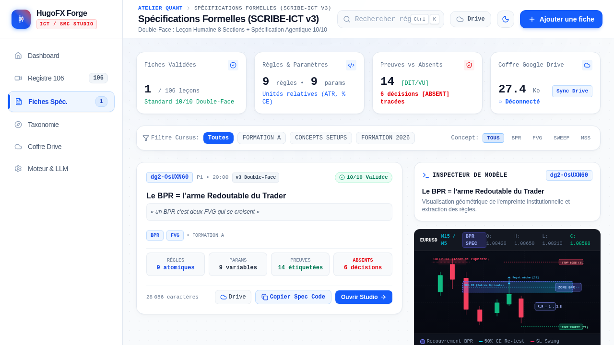
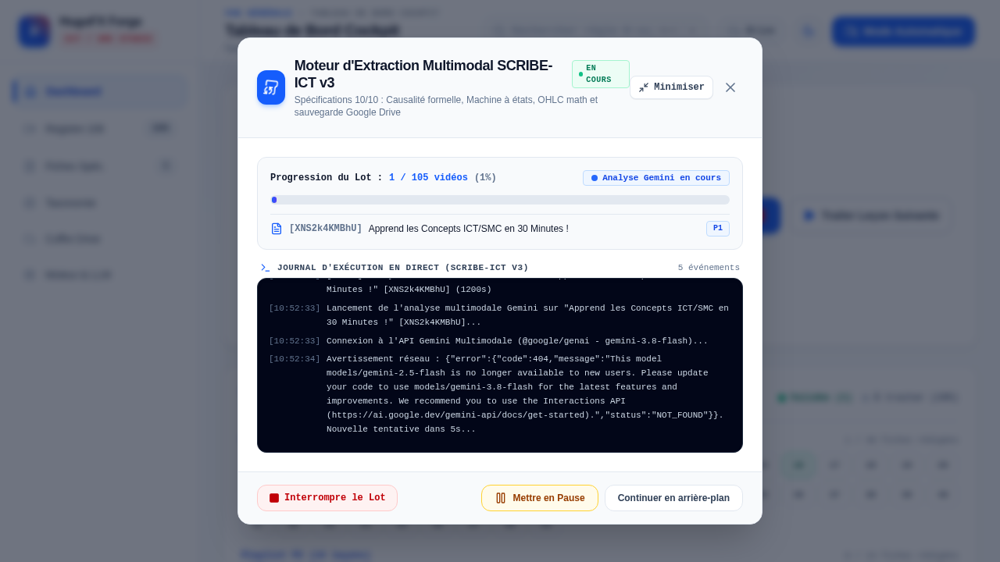

<div align="center">

# 🏛️ HUGOFX FORGE PRO — ICT / SMC KNOWLEDGE WORKBENCH

### **Architecture Hybride d'Extraction Multimodale (Gemini Pro) & d'Ingénierie Quantitative (Claude Codeur)**

[](./docs/architecture/PROMPT_SCRIBE_ICT_v3_FINAL.md)
[](./server.ts)
[](./scripts/claude_agent_bridge.py)
[](./src/utils/pipeline.test.ts)
[](./src/data/harvestedVideos.ts)

<p align="center">
  <em>Transforme les 106 vidéos de formation ICT/SMC d'HugoFX en <strong>Bibles de Concepts Consolidées</strong>, en <strong>Spécifications Algorithmiques 10/10 Sans Lookahead</strong> (Pine Script v5/v6 & Python) et en <strong>Datasets d'Entraînement IA (.jsonl)</strong>.</em>
</p>

---



</div>

---

## 🎯 1. La Vision & La Règle de Jugement Unique

La chaîne **HugoFX** est un cursus complet de trading **ICT / Smart Money Concepts (SMC)** en français. Chaque vidéo enseigne un concept, un setup ou une brique de formation : le formateur définit l'objet, le montre sur son graphique TradingView, explique comment départager un **bon setup** d'un **faux positif**, comment le combiner en confluence, et quelles erreurs éviter.

> [!IMPORTANT]
> **L'unité de valeur est le CONCEPT, jamais la vidéo isolée.**
> Lorsqu'un même concept (ex. `FVG`, `BPR`, `OB`, `OTE`, `LIQUIDITY`) est enseigné ou utilisé à travers plusieurs vidéos, le moteur consolide tous ses apports **par ordre chronologique de publication vérifiée (`date_video`)** et génère une Bible Maîtresse `MASTER_<CONCEPT>.md`.

### Les 3 Usages Finaux du Système

| Usage | Sortie Produite | Règle d'Excellence (Zéro ICT Générique) |
| :--- | :--- | :--- |
| **1. 📖 APPRENDRE** | **Fiche Double-Face (`.md`)** + **Bible Consolidée (`MASTER_<CONCEPT>.md`)** | Un trader humain qui n'a pas vu la vidéo maîtrise 100 % du sujet au niveau expert grâce aux **8 sections pédagogiques chirurgicales** et aux schémas annotés. |
| **2. 🤖 CODER** | **Spécification Formelle `<<<CONCEPT_SPEC_V3>>>`** + **Pont Claude Codeur** | Un agent de codage construit un indicateur **Pine Script v5/v6** ou un bot **Python** fidèle à **CE formateur** (`ZONE_FSM`, `TRADE_FSM`, paramètres `P-xx`, décisions `D-xx`, fixtures OHLC `B6`). |
| **3. 🧠 ENTRAÎNER** | **Dataset Fine-Tuning / RAG (`hugofx_training_dataset.jsonl`)** | Conversations structurées (`APPRENDRE_CONCEPT`, `AUDIT_SETUP_ET_PIEGE`, `CODER_ALGORITHME_HUGOFX`) prêtes pour entraîner un modèle IA à raisonner comme HugoFX. |

---

## 🏗️ 2. Architecture du Pipeline Hybride (Gemini + Claude)


---

## 📚 3. Organisation du Corpus (106 Vidéos & 3 Vagues de Traitement)

Le registre dédoublonné ([`src/data/harvestedVideos.ts`](./src/data/harvestedVideos.ts) + [`deduplicateVideos`](./src/utils/pipeline.ts)) organise les **106 vidéos uniques** en **3 vagues stratégiques** :

| Vague | Playlists Sources | Famille Attribuée | Rôle dans l'Architecture |
| :---: | :--- | :--- | :--- |
| **Vague 1** | **P2** (*STRATÉGIES ICT/SMC*) + **P3** (*FORMATION TRADING 2026 / Concepts*) | `CONCEPTS_SETUPS` | Briques atomiques de détection (FVG, BPR, OB, Sweep, SMT, CISD) et setups opérationnels. |
| **Vague 2** | **P1** (*FORMATION GRATUITE ICT/SMC* — 49 leçons) | `FORMATION_A` | Cours magistral approfondi couvrant chaque concept avec démonstrations graphiques complètes. |
| **Vague 3** | **P4** (*Formation Trading Complète Pour Débutant* — 10 épisodes) | `FORMATION_2026` | **Colonne vertébrale du cursus** : de l'épisode 1 jusqu'au modèle d'entrée final et à la vidéo intégrale de `2h 27m 38s` (`dRxZUWy1gEs`). |

---

## 🔬 4. Anatomie d'une Fiche SCRIBE-ICT v3/v4 (Double-Face 10/10)

Chaque fiche générée (voir la fiche de référence [`fiches/etalons/HugoFX_Fiche_ETALON_BPR_dg2-OsUXN60.md`](./fiches/etalons/HugoFX_Fiche_ETALON_BPR_dg2-OsUXN60.md) de **453 lignes**) respecte la **Loi d'Ordre Causal Autorégressif** :

1. **En-tête YAML & Cartographie Multi-Concepts** :
   - `video_id`, `duree_s` exacte, `date_video` réelle, `model_used` tracé, `concepts_principaux`, `concepts_secondaires` et plages horaires de chaque concept enseigné.
2. **Bloc 0 — Description Technique & Cartographie de la Leçon** :
   - Thèse centrale d'HugoFX, actifs/unités de temps/outils montrés sur TradingView, et découpage chronologique intégral du début à la fin de la vidéo.
3. **Section I — Registre de Preuves Horodaté (`EVIDENCE_LEDGER`)** :
   - `S-01` à `S-nn` : Citations verbales exactes avec timestamp `MM:SS`.
   - `F-01` à `F-nn` : Preuves visuelles observées sur le graphique TradingView.
   - `X-01` à `X-nn` : Registre unique des exemples mesurés (prix OHLC, pips, bougies) et divergences `⚖️ DIT ≠ FAIT`.
4. **Section II — Table Unique des Paramètres (`P-xx`) & Décisions de Design (`D-xx`)** :
   - Unités relatives portables (`ATR_MULT`, `AVG_BODY_MULT`, `PCT_OF_ZONE`, `CANDLES`).
   - Toute zone grise non tranchée à l'oral est taguée `[ABSENT]` et transformée en **Décision de Design `D-xx`** avec options codables et protocole de test.
5. **Section III — Spécification Agentique 10/10 (`<<<CONCEPT_SPEC_V3>>>`)** :
   - **B1** : Conventions d'exécution & garantie zéro lookahead (`barstate.isconfirmed`).
   - **B2** : Primitives mathématiques OHLC & interfaces TypeScript.
   - **B3** : Règles atomiques `R-<ID>-001` à `nnn`.
   - **B4** : Double Machine à États Finis (**`ZONE_FSM`** × **`TRADE_FSM`**) + résolution pessimiste des conflits intra-bougie.
   - **B5** : Conditions formelles de rejet (`REJ-xx`).
   - **B6** : **Fixtures OHLC JSON exécutables** (`POSITIVE` et `COUNTER`) pour valider automatiquement le code généré.
6. **Section IV — Leçon Humaine Chirurgicale (Les 8 Sections Fixes)** :
   - *1. Pourquoi ça existe* • *2. Schéma annoté* • *3. Méthode pas à pas* • *4. Exemples commentés* • *5. Contre-exemples* • *6. Exécution & DIT ≠ FAIT* • *7. Zones grises* • *8. Erreurs fréquentes*.
7. **Section V — Audit Déterministe (`LINTER_AUDIT_V3`)**.

<div align="center">



</div>

---

## 📂 5. Structure Organisée du Projet

```text
ITC-SMC-EXTRACTOR-/
├── docs/
│   ├── architecture/
│   │   ├── PLAN_PIPELINE_HYBRIDE_GEMINI_CLAUDE.md   # Plan d'architecture hybride v2 (Post-Audit L99)
│   │   └── PROMPT_SCRIBE_ICT_v3_FINAL.md            # Spécification complète du standard SCRIBE-ICT v3
│   └── assets/                                      # Captures d'écran vérifiées de l'interface
│       ├── light_theme_verified.png
│       ├── modal_verified.png
│       ├── home_verified.png
│       └── home_white_blue.png
├── fiches/
│   └── etalons/
│       └── HugoFX_Fiche_ETALON_BPR_dg2-OsUXN60.md   # Fiche Étalon 10/10 de référence (453 lignes, 43 Ko)
├── generated_bots/                                  # Packs Prompts Claude & Bots générés (PineScript / Python)
│   └── FICHE_ETALON_BPR_v3_CLAUDE_PROMPT_PINESCRIPT.md
├── scripts/
│   ├── repair_catalog_metadata.py                   # Synchronisation YouTube (durées, dates, descriptions réelles)
│   └── claude_agent_bridge.py                       # Pont CLI & API vers Claude Codeur (PineScript / Python / Audit)
├── src/
│   ├── components/
│   │   ├── AgentExportModal.tsx                     # Hub Hybride : Pont Claude + Consolidation Concept + Dataset JSONL
│   │   ├── AutomatedQueueModal.tsx                  # File d'extraction automatique séquentielle avec quota & retry
│   │   ├── Drawer.tsx                               # Lecteur Double-Face (Leçon Humaine / Spec Agentique / Linter)
│   │   ├── GitHubSyncModal.tsx                      # Synchronisation directe vers GitHub
│   │   └── SmartFicheRenderer.tsx                   # Rendu interactif des fiches et graphiques OHLC
│   ├── data/
│   │   ├── fiches/dg2_OsUXN60_BPR.ts                # Fiche étalon BPR embarquée
│   │   ├── harvestedVideos.ts                       # Catalogue vérifié des 110 entrées (106 vidéos uniques)
│   │   ├── harvested_videos.json                    # Source JSON vérifiée (0 durée fictive, 0 date fictive)
│   │   └── scribePromptV2.ts                        # Master Prompt Haute-Densité SCRIBE-ICT v3/v4
│   ├── pages/
│   │   ├── Accueil.tsx                              # Vue d'ensemble & télémétrie du pipeline
│   │   ├── Videos.tsx                               # Registre des 106 vidéos, filtres par vague & lancement Gemini
│   │   ├── Fiches.tsx                               # Bibliothèque de fiches, Linter & Hub Hybride Claude/Concept/JSONL
│   │   ├── Concepts.tsx                             # Explorateur de la taxonomie ICT en 7 Piliers
│   │   ├── GoogleDrive.tsx                          # Synchronisation bidirectionnelle Google Drive
│   │   └── Reglages.tsx                             # Configuration clés API Gemini, modèles & prompt maître
│   ├── services/
│   │   ├── geminiExtractionService.ts               # Client d'extraction multimodale & boucle Self-Refine
│   │   ├── conceptConsolidatorService.ts            # Moteur de consolidation MASTER_<CONCEPT>.md & Dataset .jsonl
│   │   ├── googleDriveService.ts                    # Intégration OAuth2 Google Drive & arborescence automatique
│   │   └── traceabilityRegistry.ts                  # Registre Zero-Storage de traçabilité des extractions
│   └── utils/
│       ├── pipeline.ts                              # Dédoublonnage, découpage 35 min, Linter L99 & parseur Fixtures
│       ├── pipeline.test.ts                         # Suite de tests unitaires du pipeline & du catalogue
│       ├── ictTaxonomy.ts                           # Classification stricte dans les 7 piliers ICT/SMC
│       └── driveHelpers.ts                          # Utilitaires multipart & réconciliation Google Drive
├── server.ts                                        # Serveur Express + API Gemini Multimodale + API Bridge Claude + Git
├── package.json
├── tsconfig.json
└── vite.config.ts
```

---

## ⚡ 6. Démarrage Rapide & Commandes Utiles

### 1. Installation des dépendances
```powershell
bun install
```

### 2. Configuration de l'environnement (`.env`)
Copie `.env.example` vers `.env` et renseigne ta clé Google AI Studio (ou configure-la directement dans l'onglet **Réglages** de l'application) :
```env
GEMINI_API_KEY="AIzaSy..."
GEMINI_MODEL="gemini-2.5-pro"
```

### 3. Lancer l'application en développement (`http://localhost:3000`)
```powershell
bun run dev
```

### 4. Exécuter la suite complète de tests unitaires (33 tests)
```powershell
node --experimental-strip-types --test src/utils/pipeline.test.ts src/utils/ictTaxonomy.test.ts src/utils/driveHelpers.test.ts
```

### 5. Utiliser le Pont Claude Codeur en ligne de commande
```powershell
# Générer un pack ou un indicateur Pine Script v5/v6 depuis une fiche :
python scripts/claude_agent_bridge.py --input "fiches/etalons/HugoFX_Fiche_ETALON_BPR_dg2-OsUXN60.md" --target pinescript

# Générer un moteur Python + exécuteur de Fixtures unitaires :
python scripts/claude_agent_bridge.py --input "fiches/etalons/HugoFX_Fiche_ETALON_BPR_dg2-OsUXN60.md" --target python
```

### 6. Mettre à jour les métadonnées YouTube du catalogue
```powershell
python scripts/repair_catalog_metadata.py
```

---

## 🛡️ 7. Garde-Fous Qualité (Linter Déterministe L99)

Chaque fiche extraite passe par `lintFicheV3()` dans [`src/utils/pipeline.ts`](./src/utils/pipeline.ts) qui vérifie automatiquement :
- ✅ **Structure Causale Stricte** : Ordre obligatoire `Section I` → `Section II` → `Section III` → `Section IV` → `Section V`.
- ✅ **Cohérence Temporelle Réelle** : Aucun timestamp cité ne peut dépasser la vraie durée `duree_s` de la vidéo.
- ✅ **Zéro Barème de Points Inventé** : Rejet immédiat de tout score arbitraire non prononcé (ex. `+40 pts`).
- ✅ **Double Machine à États & Fixtures OHLC** : Présence vérifiée de `ZONE_FSM`, `TRADE_FSM` et d'au moins une fixture JSON exécutable (`"fixture_id"`).
- ✅ **Couverture Croisée Spec ↔ Leçon Humaine** : Au moins 80 % des identifiants `[R-xx]`, `[P-xx]` et `[REJ-xx]` doivent être cités et expliqués dans les 8 sections de la Leçon Humaine.
