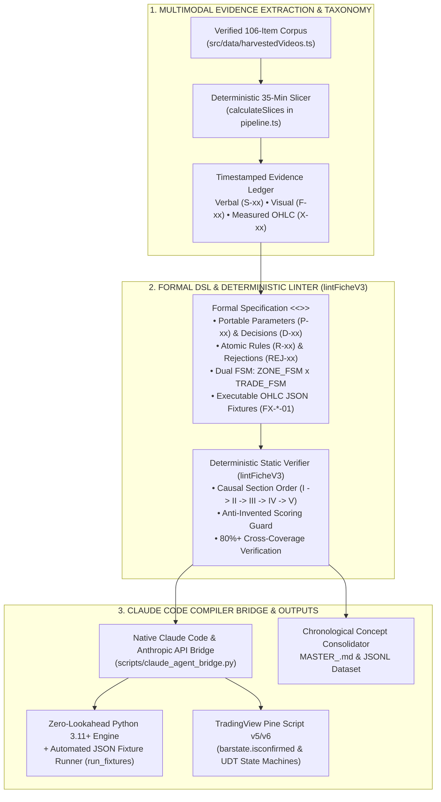
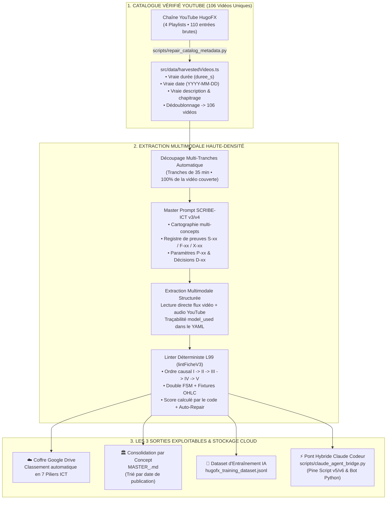

<div align="center">

# 🏛️ ITC-SMC-EXTRACTOR (`v3.4.0`)

### **Open-Source Formal DSL Compiler, Deterministic Zero-Lookahead FSM Linter (`ZONE_FSM` × `TRADE_FSM`), and Native Claude Code Bridge for Market Microstructure**

[](./LICENSE)
[](./src/utils/pipeline.test.ts)
[](./scripts/claude_agent_bridge.py)
[](./docs/architecture/PROMPT_SCRIBE_ICT_v3_FINAL.md)
[-111827?style=for-the-badge)](https://github.com/Christ-yavn/bot-quant-)

<p align="center">
  <strong>🌐 <a href="#-english-documentation">English Documentation</a></strong> •
  <strong>🇫🇷 <a href="#-documentation-française-complète">Documentation Française</a></strong> •
  <strong>🤖 <a href="./AGENT.md">Claude Code Contract (<code>AGENT.md</code>)</a></strong> •
  <strong>🤝 <a href="./CONTRIBUTING.md">Contributing Guide</a></strong>
</p>

<p align="center">
  <em>Compiles unstructured market-microstructure & ICT/SMC domain knowledge into <strong>provably causal, zero-lookahead Dual Finite State Machines (<code>ZONE_FSM</code> × <code>TRADE_FSM</code>)</strong>, deterministic <strong>OHLC JSON test fixtures</strong>, and executable <strong>Python 3.11+ / TradingView Pine Script v5–v6</strong> engines powered by <strong>Claude Code</strong>.</em>
</p>

---


</div>

---

# 🌐 English Documentation

## 1. The Ecosystem Gap: Why `ITC-SMC-EXTRACTOR` Exists

In open-source quantitative finance, traditional technical indicators (such as RSI, MACD, or Bollinger Bands) are well served by libraries like `TA-Lib`, `pandas-ta`, and `VectorBT`. However, **structural price-delivery and market-microstructure primitives**—commonly known as **Smart Money Concepts (SMC) / ICT** (*Fair Value Gaps (FVG)*, *Balanced Price Ranges (BPR)*, *Order Blocks (OB)*, *Liquidity Sweeps*, *Change in State of Delivery (CISD)*, and *Market Structure Shifts (MSS)*)—suffer from three critical flaws across existing public implementations:

1. **Severe Look-Ahead Bias**: Most open-source scripts detect 3-bar imbalances or swing fractals using future bar indices ($t+1, t+2$) without enforcing strict bar-close causality (`barstate.isconfirmed`), invalidating backtest results.
2. **State Ambiguity & Intra-Bar Conflicts**: Existing implementations rarely formalize when a structural zone transitions from `FORMING` to `ACTIVE`, `MITIGATED`, or `INVALIDATED`, or how simultaneous Stop-Loss and Take-Profit touches within a single bar are resolved.
3. **Hallucinated Heuristics in LLM Code Generation**: Asking an LLM to "code an ICT Order Block or BPR strategy" produces generic, unverified approximations with arbitrary point-scoring rules rather than deterministic state machines.

**`ITC-SMC-EXTRACTOR` solves this gap** by introducing:
- **`SCRIBE-ICT v3/v4` (`<<<CONCEPT_SPEC_V3>>>`)**: A formal Domain-Specific Language (DSL) that encodes structural market primitives into atomic rules (`R-xx`), portable relative parameters (`P-xx` in `ATR_MULT`, `PCT_OF_ZONE`, `CANDLES`), explicit design decisions (`D-xx`), formal rejection predicates (`REJ-xx`), and **Dual Finite State Machines (`ZONE_FSM` × `TRADE_FSM`)**.
- **`lintFicheV3()` ([`src/utils/pipeline.ts`](./src/utils/pipeline.ts))**: A deterministic TypeScript static verifier (backed by **33 unit tests**) that rejects any specification containing temporal inconsistencies, invented point-scoring heuristics, missing state transitions, or missing OHLC test fixtures.
- **`claude_agent_bridge.py` ([`scripts/claude_agent_bridge.py`](./scripts/claude_agent_bridge.py))**: A native **Anthropic Messages API & Claude Code CLI (`claude -p`) compiler bridge** that translates verified `<<<CONCEPT_SPEC_V3>>>` specifications into zero-lookahead **Python 3.11+ event-driven engines** (with self-asserting JSON OHLC fixture runners) and **Pine Script v5/v6** indicators.

---

## 2. Two-Repository Open-Source Quantitative Ecosystem

This repository is part of a modular two-repository open-source suite maintained by [@Christ-yavn](https://github.com/Christ-yavn):

| Repository | Primary Stack | Role in the Open-Source Ecosystem |
| :--- | :--- | :--- |
| **[`Christ-yavn/ITC-SMC-EXTRACTOR-`](https://github.com/Christ-yavn/ITC-SMC-EXTRACTOR-)** *(This Repo)* | TypeScript, React 19, Node.js 22, Python 3.12 | **Formal Specification Workbench, Deterministic FSM Linter (`lintFicheV3`), & Claude Code Compiler Bridge** (`ZONE_FSM` / `TRADE_FSM` + OHLC JSON Fixtures + `.jsonl` RAG/Fine-Tuning Dataset generator). |
| **[`Christ-yavn/bot-quant-`](https://github.com/Christ-yavn/bot-quant-)** *(Companion Engine)* | Python 3.12, ONNX Runtime, MQL5 / C++ | **Zero-Lookahead Quantitative Research, Statistical Validation & Low-Latency Execution Engine** (Poisson survival analysis, volatility-squeeze GBDT models exported to `.onnx`, live spread-adjusted EV gates, and `AGENT.md` workflow). |

---

## 3. System Architecture & Claude Code Compilation Pipeline



---

## 4. Quickstart & CLI Usage

### Prerequisites
- **Node.js 22+** (or **Bun 1.1+**)
- **Python 3.11+** (for the Claude Code CLI / Anthropic API compilation bridge)

### 1. Clone & Install
```bash
git clone https://github.com/Christ-yavn/ITC-SMC-EXTRACTOR-.git
cd ITC-SMC-EXTRACTOR-
npm install
```

### 2. Run the 33 Deterministic Unit Tests
```bash
npm test
# Executes: node --experimental-strip-types --test src/utils/pipeline.test.ts src/utils/ictTaxonomy.test.ts src/utils/driveHelpers.test.ts
```

### 3. Compile a Formal Specification into Python or Pine Script via Claude Code
`scripts/claude_agent_bridge.py` natively supports both the **Anthropic Messages API** (`ANTHROPIC_API_KEY`) and the local **Claude Code CLI** (`claude -p`), and always outputs a deterministic, self-contained compilation pack in `generated_bots/`:

```bash
# Generate a zero-lookahead Python 3.11+ state-machine engine with automated OHLC fixture assertions:
python scripts/claude_agent_bridge.py \
  --input "fiches/etalons/HugoFX_Fiche_ETALON_BPR_dg2-OsUXN60.md" \
  --target python

# Generate a zero-lookahead TradingView Pine Script v5/v6 indicator & strategy:
python scripts/claude_agent_bridge.py \
  --input "fiches/etalons/HugoFX_Fiche_ETALON_BPR_dg2-OsUXN60.md" \
  --target pinescript

# Run an adversarial Red-Team mathematical completeness audit on a specification:
python scripts/claude_agent_bridge.py \
  --input "fiches/etalons/HugoFX_Fiche_ETALON_BPR_dg2-OsUXN60.md" \
  --target audit
```

### 4. Launch the Interactive Workbench (`http://localhost:3000`)
```bash
npm run dev
```

---

## 5. Deterministic Verification Guarantees (`lintFicheV3`)

Every specification processed by [`src/utils/pipeline.ts`](./src/utils/pipeline.ts) is audited against 6 non-negotiable formal checks before compilation:
- ✅ **Autoregressive Causal Structure**: Enforces strict ordering `Section I (Evidence Ledger)` → `Section II (Parameters & Decisions)` → `Section III (Formal Spec & Dual FSM)` → `Section IV (8-Part Human Lesson)` → `Section V (Linter Audit)`.
- ✅ **Temporal Bound Verification**: Rejects any cited timestamp exceeding the verified duration `duree_s` of the source material.
- ✅ **Zero Invented Heuristic Scoring**: Automatically flags and rejects arbitrary point systems (`+40 pts`, `score >= 75%`) not grounded in explicit structural predicates.
- ✅ **Dual Finite State Machine (`ZONE_FSM` × `TRADE_FSM`)**: Verifies explicit state transitions and pessimistic intra-bar conflict resolution.
- ✅ **Executable OHLC JSON Fixtures (`B6`)**: Parses and validates embedded JSON OHLC bar arrays (`POSITIVE` and `COUNTER` test cases) via `parseFixturesFromContent()`.
- ✅ **80%+ Bidirectional Traceability**: Ensures at least 80% of formal IDs (`[R-xx]`, `[P-xx]`, `[REJ-xx]`) are cross-referenced and explained in the human documentation.

---

<br/>

# 🇫🇷 Documentation Française Complète

<div align="center">

### **Architecture Hybride d'Extraction Multimodale & d'Ingénierie Quantitative (Claude Codeur)**

</div>

## 🎯 1. La Vision & La Règle de Jugement Unique

La chaîne **HugoFX** est un cursus complet de trading **ICT / Smart Money Concepts (SMC)** en français. Chaque vidéo enseigne un concept, un setup ou une brique de formation : le formateur définit l'objet, le montre sur son graphique TradingView, explique comment départager un **bon setup** d'un **faux positif**, comment le combiner en confluence, et quelles erreurs éviter.

> [!IMPORTANT]
> **L'unité de valeur est le CONCEPT, jamais la vidéo isolée.**
> Lorsqu'un même concept (ex. `FVG`, `BPR`, `OB`, `OTE`, `LIQUIDITY`) est enseigné ou utilisé à travers plusieurs vidéos, le moteur consolide tous ses apports **par ordre chronologique de publication vérifiée (`date_video`)** et génère une Bible Maîtresse `MASTER_<CONCEPT>.md`.

### Les 3 Usages Finaux du Système

| Usage | Sortie Produite | Règle d'Excellence (Zéro ICT Générique) |
| :--- | :--- | :--- |
| **1. 📖 APPRENDRE** | **Fiche Double-Face (`.md`)** + **Bible Consolidée (`MASTER_<CONCEPT>.md`)** | Un trader humain qui n'a pas vu la vidéo maîtrise 100 % du sujet au niveau expert grâce aux **8 sections pédagogiques chirurgicales** et aux schémas annotés. |
| **2. 🤖 CODER** | **Spécification Formelle `<<<CONCEPT_SPEC_V3>>>`** + **Pont Claude Codeur** | Un agent de codage construit un indicateur **Pine Script v5/v6** ou un bot **Python** fidèle à **CE formateur** (`ZONE_FSM`, `TRADE_FSM`, paramètres `P-xx`, décisions `D-xx`, fixtures OHLC `B6`). |
| **3. 🧠 ENTRAÎNER** | **Dataset Fine-Tuning / RAG (`hugofx_training_dataset.jsonl`)** | Conversations structurées (`APPRENDRE_CONCEPT`, `AUDIT_SETUP_ET_PIEGE`, `CODER_ALGORITHME_HUGOFX`) prêtes pour entraîner un modèle IA à raisonner comme HugoFX. |

---

## 🏗️ 2. Architecture du Pipeline Hybride (Extraction + Compilation Claude Code)



---

## 📚 3. Organisation du Corpus (106 Vidéos & 3 Vagues de Traitement)

Le registre dédoublonné ([`src/data/harvestedVideos.ts`](./src/data/harvestedVideos.ts) + [`deduplicateVideos`](./src/utils/pipeline.ts)) organise les **106 vidéos uniques** en **3 vagues stratégiques** :

| Vague | Playlists Sources | Famille Attribuée | Rôle dans l'Architecture |
| :---: | :--- | :--- | :--- |
| **Vague 1** | **P2** (*STRATÉGIES ICT/SMC*) + **P3** (*FORMATION TRADING 2026 / Concepts*) | `CONCEPTS_SETUPS` | Briques atomiques de détection (FVG, BPR, OB, Sweep, SMT, CISD) et setups opérationnels. |
| **Vague 2** | **P1** (*FORMATION GRATUITE ICT/SMC* — 49 leçons) | `FORMATION_A` | Cours magistral approfondi couvrant chaque concept avec démonstrations graphiques complètes. |
| **Vague 3** | **P4** (*Formation Trading Complète Pour Débutant* — 10 épisodes) | `FORMATION_2026` | **Colonne vertébrale du cursus** : de l'épisode 1 jusqu'au modèle d'entrée final et à la vidéo intégrale de `2h 27m 38s` (`dRxZUWy1gEs`). |

---

## 🔬 4. Anatomie d'une Fiche SCRIBE-ICT v3/v4 (Double-Face 10/10)

Chaque fiche générée (voir la fiche de référence [`fiches/etalons/HugoFX_Fiche_ETALON_BPR_dg2-OsUXN60.md`](./fiches/etalons/HugoFX_Fiche_ETALON_BPR_dg2-OsUXN60.md) de **453 lignes**) respecte la **Loi d'Ordre Causal Autorégressif** :

1. **En-tête YAML & Cartographie Multi-Concepts** :
   - `video_id`, `duree_s` exacte, `date_video` réelle, `model_used` tracé, `concepts_principaux`, `concepts_secondaires` et plages horaires de chaque concept enseigné.
2. **Bloc 0 — Description Technique & Cartographie de la Leçon** :
   - Thèse centrale d'HugoFX, actifs/unités de temps/outils montrés sur TradingView, et découpage chronologique intégral du début à la fin de la vidéo.
3. **Section I — Registre de Preuves Horodaté (`EVIDENCE_LEDGER`)** :
   - `S-01` à `S-nn` : Citations verbales exactes avec timestamp `MM:SS`.
   - `F-01` à `F-nn` : Preuves visuelles observées sur le graphique TradingView.
   - `X-01` à `X-nn` : Registre unique des exemples mesurés (prix OHLC, pips, bougies) et divergences `⚖️ DIT ≠ FAIT`.
4. **Section II — Table Unique des Paramètres (`P-xx`) & Décisions de Design (`D-xx`)** :
   - Unités relatives portables (`ATR_MULT`, `AVG_BODY_MULT`, `PCT_OF_ZONE`, `CANDLES`).
   - Toute zone grise non tranchée à l'oral est taguée `[ABSENT]` et transformée en **Décision de Design `D-xx`** avec options codables et protocole de test.
5. **Section III — Spécification Agentique 10/10 (`<<<CONCEPT_SPEC_V3>>>`)** :
   - **B1** : Conventions d'exécution & garantie zéro lookahead (`barstate.isconfirmed`).
   - **B2** : Primitives mathématiques OHLC & interfaces TypeScript.
   - **B3** : Règles atomiques `R-<ID>-001` à `nnn`.
   - **B4** : Double Machine à États Finis (**`ZONE_FSM`** × **`TRADE_FSM`**) + résolution pessimiste des conflits intra-bougie.
   - **B5** : Conditions formelles de rejet (`REJ-xx`).
   - **B6** : **Fixtures OHLC JSON exécutables** (`POSITIVE` et `COUNTER`) pour valider automatiquement le code généré.
6. **Section IV — Leçon Humaine Chirurgicale (Les 8 Sections Fixes)** :
   - *1. Pourquoi ça existe* • *2. Schéma annoté* • *3. Méthode pas à pas* • *4. Exemples commentés* • *5. Contre-exemples* • *6. Exécution & DIT ≠ FAIT* • *7. Zones grises* • *8. Erreurs fréquentes*.
7. **Section V — Audit Déterministe (`LINTER_AUDIT_V3`)**.

<div align="center">


</div>

---

## 📂 5. Structure Organisée du Projet

```text
ITC-SMC-EXTRACTOR-/
├── .github/workflows/ci.yml                         # Pipeline CI GitHub Actions (33 tests unitaires + Bridge Claude)
├── docs/
│   ├── architecture/
│   │   ├── PLAN_PIPELINE_HYBRIDE_GEMINI_CLAUDE.md   # Plan d'architecture hybride v2 (Post-Audit L99)
│   │   └── PROMPT_SCRIBE_ICT_v3_FINAL.md            # Spécification complète du standard SCRIBE-ICT v3
│   └── assets/                                      # Captures d'écran vérifiées de l'interface
├── fiches/
│   └── etalons/
│       └── HugoFX_Fiche_ETALON_BPR_dg2-OsUXN60.md   # Fiche Étalon 10/10 de référence (453 lignes, 43 Ko)
├── generated_bots/                                  # Packs Prompts Claude & Bots générés (PineScript / Python)
├── scripts/
│   ├── repair_catalog_metadata.py                   # Synchronisation YouTube (durées, dates, descriptions réelles)
│   └── claude_agent_bridge.py                       # Pont CLI & API vers Claude Codeur (PineScript / Python / Audit)
├── src/
│   ├── components/                                  # Composants UI React 19 (AgentExportModal, SmartFicheRenderer...)
│   ├── data/                                        # Catalogue vérifié (106 vidéos) & Fiche Étalon BPR
│   ├── pages/                                       # Pages du Workbench (Accueil, Videos, Fiches, Concepts...)
│   ├── services/                                    # Consolidateur MASTER_<CONCEPT>.md & Dataset .jsonl
│   └── utils/
│       ├── pipeline.ts                              # Dédoublonnage, découpage 35 min, Linter L99 & parseur Fixtures
│       ├── pipeline.test.ts                         # Suite de tests unitaires du pipeline & du catalogue
│       ├── ictTaxonomy.ts                           # Classification stricte dans les 7 piliers ICT/SMC
│       └── driveHelpers.ts                          # Utilitaires multipart & réconciliation Google Drive
├── AGENT.md                                         # Contrat opérationnel strict pour Claude Code
├── CONTRIBUTING.md                                  # Guide de contribution Open Source
├── SECURITY.md                                      # Politique de sécurité & hygiène des clés API
├── LICENSE                                          # Licence Open Source MIT
├── server.ts                                        # Serveur Express + API Bridge Claude + Git
└── package.json
```

---

## 📄 License

Released under the **[MIT License](./LICENSE)**. Copyright (c) 2026 [Christ Yvan (`@Christ-yavn`)](https://github.com/Christ-yavn).
