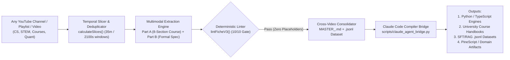

# Universal Video-to-Course, Formal Specification & AI Dataset Compiler (`v4.0.0`)

[](https://github.com/Christ-yavn/ITC-SMC-EXTRACTOR-/actions/workflows/ci.yml)
[](./LICENSE)
[](./package.json)
[](./scripts/claude_agent_bridge.py)
[](./src/utils/pipeline.test.ts)

> **Turn ANY YouTube channel, university lecture playlist, or technical video curriculum into structured 8-section course handbooks, consolidated Master Concept Bibles (`MASTER_<CONCEPT>.md`), deterministic Dual-FSM formal specifications, `.jsonl` SFT/RAG training datasets, and unit-tested production code via Anthropic's Claude Code.**

---

## 1. The Ecosystem Gap We Solve

Technical and educational knowledge on YouTube (computer science lectures, system design walkthroughs, STEM courses, quantitative seminars, and domain-specific masterclasses) is trapped inside **unstructured multi-hour video streams** where concepts are explained visually on slides, whiteboards, or charts rather than in transcripts alone.

When developers or educators ask an LLM to summarize a video transcript or generate code from a tutorial, three systemic failure modes occur:
1. **Transcript Blindness & Mid-Video Degradation**: Long lectures (>35 minutes) suffer severe middle-context recall loss, and text-only transcripts miss visual diagrams, cursor annotations, and mathematical derivations shown on screen.
2. **Prose Ambiguity & Hallucinated Rules**: Standard video summaries produce vague prose full of unstated parameters and `TODO` placeholders rather than formal, testable specifications.
3. **Cross-Video Contradictions**: A 100-video channel teaches the same concept across beginner, intermediate, and advanced playlists over multiple years without a deterministic consolidation protocol.

**This repository solves all three problems** by acting as a **Universal Multimodal Video-to-Course, Formal Specification & Dataset Compiler** coupled with a **10-criteria deterministic linter (`lintFicheV3`)** and a **Native Claude Code Compiler Bridge (`scripts/claude_agent_bridge.py`)**.

---

## 2. End-to-End Compiler Architecture



---

## 3. Four Universal Compilation Domain Profiles (`src/utils/domainProfiles.ts`)

While this compiler ships with a full **106-video Market Microstructure & Quantitative Finance benchmark corpus**, its core pipeline (`src/utils/pipeline.ts` + `src/utils/domainProfiles.ts`) supports **any educational or technical video channel** out of the box:

| Domain Profile ID | Target Video Channels | Dual Finite State Machines | Primary Compilation Outputs |
| :--- | :--- | :--- | :--- |
| **`UNIVERSAL_COURSE_COMPILER`** | Any educational YouTube channel, MOOC, university course, or tutorial playlist | `CONCEPT_LIFECYCLE_FSM` × `APPLICATION_WORKFLOW_FSM` | 8-Section Study Handbooks, `MASTER_<CONCEPT>.md` Bibles, Flashcards & `.jsonl` SFT/RAG Datasets |
| **`SOFTWARE_AND_ALGORITHMS`** | Programming tutorials, distributed systems, CS lectures, AI engineering talks | `COMPONENT_STATE_FSM` × `EXECUTION_PIPELINE_FSM` | Strict TypeScript / Python modules, API contracts, JSON test vectors & `node:test` suites |
| **`STEM_AND_QUANT_SCIENCE`** | Mathematics, physics, econometrics, statistics & quantitative seminars | `REGIME_STATE_FSM` × `INFERENCE_DECISION_FSM` | Formal theorem/proof sheets, numerical invariants `[R-xx]` & reproducible Python engines |
| **`MARKET_MICROSTRUCTURE_ICT`** | Discretionary market microstructure & algorithmic trading playlists (*106-video benchmark included*) | `ZONE_FSM` × `TRADE_FSM` | Zero-lookahead Python event-driven backtesters, synthetic OHLC JSON fixtures & PineScript v5/v6 |

---

## 4. Key Compiler Subsystems

### 4.1 Automatic 35-Minute Temporal Slicing & Multi-Playlist Deduplication
- **`calculateSlices(videoId, durationSeconds, 2100)`**: Automatically splits any video longer than 35 minutes (`2100s`) into sequential temporal slices (`_S01`, `_S02`, ...) so multimodal extraction never drops middle-of-lecture details.
- **`deduplicateVideos(items)`**: Deduplicates videos appearing across multiple playlists while preserving full curriculum hierarchy.

### 4.2 Dual-Layer Output Specification (Human Course + Machine Formalism)
Every compiled video produces a rigorous two-part Markdown specification:
- **Part A — 8-Section Pedagogical Course Handbook**:
  1. Pedagogical Objective & Prerequisites
  2. Visual Intuition & Mental Models (anchored to exact `[MM:SS]` video timestamps)
  3. Formal Definitions & Core Axioms
  4. Step-by-Step Worked Examples from the Video
  5. Common Mistakes, Counter-Examples & Edge Cases
  6. Operational Checklist & Decision Tree
  7. Cross-Video Synthesis & Curriculum Dependencies
  8. Self-Assessment Quiz & Active Recall Flashcards
- **Part B — Deterministic Machine Specification**:
  - **Parameter & Decision Tables (`[P-01]..[P-nn]`, `[D-01]..[D-nn]`)**: Explicit types, default values, and sensitivity bounds.
  - **Formal Testable Rules & Rejection Guards (`[R-01]..[R-nn]`, `[REJ-01]..[REJ-nn]`)**: Zero-ambiguity boolean invariants.
  - **Dual Finite State Machines**: Complete state-transition tables with deterministic conflict resolution.
  - **3 Executable JSON Verification Fixtures**: Nominal case, rejected/invalid case, and boundary case.

### 4.3 Deterministic 10-Criteria Quality Gate (`lintFicheV3`)
Before any extracted specification is accepted or passed to Claude Code, `lintFicheV3` (`src/utils/pipeline.ts`) enforces **10 deterministic checks**:
1. Zero forbidden placeholders (`TODO`, `TBD`, `...`, `etc.`).
2. Temporal causality (all `[MM:SS]` or `[HH:MM:SS]` timestamps verified against actual video duration `duree_s`).
3. Presence and completeness of all 8 human pedagogical course sections.
4. Exhaustive parameter (`[P-xx]`) and decision (`[D-xx]`) definitions.
5. Formal boolean rules (`[R-xx]`) and explicit exclusion guards (`[REJ-xx]`).
6. Dual Finite State Machine transition tables (`PRIMARY_FSM` & `SECONDARY_FSM`).
7. Valid, parseable JSON verification fixtures (`parseFixturesFromContent`).
8. Strict anti-hallucination verification (rejects invented scoring systems not present in the source lecture).

### 4.4 Cross-Video Concept Consolidation & `.jsonl` Dataset Generation
- **`buildConsolidatedConcepts(fiches)`**: Chronologically merges specifications extracted across dozens of videos into a single **`MASTER_<CONCEPT>.md`** textbook chapter, automatically resolving terminology evolution between older and newer videos.
- **`generateTrainingDatasetJsonl(fiches)`**: Exports verified multi-turn instruction-tuning / RAG datasets (`.jsonl`) anchored in formal rules `[R-xx]` and video timestamps.

### 4.5 Native Claude Code Compiler Bridge (`scripts/claude_agent_bridge.py`)
Compiles any validated specification or `MASTER_<CONCEPT>.md` directly via **Anthropic API (`ANTHROPIC_API_KEY`)** or **Claude Code CLI (`claude -p`)** into 6 target formats:
- `--target course-handbook`: University-grade course chapter with worked examples, flashcards, and graded quizzes.
- `--target jsonl-dataset`: Multi-turn SFT / RAG fine-tuning dataset (`.jsonl`).
- `--target typescript`: Strict ESM TypeScript state machine module with embedded `node:test` verification.
- `--target python`: Strict Python 3.11+ `dataclasses` engine with automated `run_fixtures()` assertion runner.
- `--target pinescript`: Zero-lookahead TradingView PineScript v5/v6 strategy/indicator.
- `--target audit`: Formal completeness, causality, and Red-Team audit report.

---

## 5. Quickstart & Verification

### Run the 38 Deterministic Unit Tests (Zero External Dependencies)
```bash
npm test
# Runs: node --experimental-strip-types --test src/utils/pipeline.test.ts src/utils/ictTaxonomy.test.ts src/utils/driveHelpers.test.ts src/utils/domainProfiles.test.ts
# Result: 38/38 passing
```

### Ingest Any YouTube Video or Lecture Series (Universal CLI)
```bash
python scripts/universal_youtube_ingest.py \
  --url "https://www.youtube.com/watch?v=dQw4w9WgXcQ" \
  --title "Distributed Consensus & State Machine Replication" \
  --channel "MIT OpenCourseWare" \
  --duration 4500 \
  --domain SOFTWARE_AND_ALGORITHMS
```

### Compile a Validated Specification via Claude Code
```bash
# Compile to a complete University/Pedagogical Course Handbook
python scripts/claude_agent_bridge.py \
  --input "fiches/etalons/HugoFX_Fiche_ETALON_BPR_dg2-OsUXN60.md" \
  --target course-handbook

# Compile to a strict TypeScript ESM State Machine + Test Suite
python scripts/claude_agent_bridge.py \
  --input "fiches/etalons/HugoFX_Fiche_ETALON_BPR_dg2-OsUXN60.md" \
  --target typescript

# Compile to a Python 3.11+ Engine with Automated JSON Fixture Verification
python scripts/claude_agent_bridge.py \
  --input "fiches/etalons/HugoFX_Fiche_ETALON_BPR_dg2-OsUXN60.md" \
  --target python
```

### Launch the Interactive Web Studio (React 19 + Express + Vite)
```bash
npm install
npm run dev
```

---

## 6. Included Real-World Benchmark Dataset (106 Technical Videos)

To prove the compiler on a noisy, visually dense real-world domain, this repository includes a complete **106-video benchmark catalog** (`src/data/harvestedVideos.ts`) with real durations, publication dates, multi-playlist mappings, and gold-standard reference specifications (`fiches/etalons/HugoFX_Fiche_ETALON_BPR_dg2-OsUXN60.md` and `src/utils/etalonBpr.ts`) achieving a verified **10/10 score** on `lintFicheV3`.

---

## 7. Companion Open-Source Project in Our Suite

- **[`Christ-yavn/quant-pod`](https://github.com/Christ-yavn/quant-pod) (Quant Pod v3.0)**: Autonomous Multi-Agent Quantitative Research Skill (`SKILL.md` for Claude Code) & 10 Pure-Python Scientific Engines (SHA-256 Merkle Research Ledger, NIST SP 800-22/90B CSPRNG Forensics, UCB1 + AST Regularization Alpha Discovery, Zero-Lookahead Event Backtester, and Blind Adversarial Validation via DSR $N_{\text{eff}}$, Hansen SPA, Romano-Wolf StepM, and PBO).

---

## 8. Version Française (Résumé Exécutif)

**Compilateur Universel Vidéo/YouTube vers Cours Structurés, Spécifications Formelles, Datasets `.jsonl` et Code Exécutable via Claude Code (`v4.0.0`)** :
- **Universel (4 Profils de Domaines)** : Permet d'ingérer **n'importe quelle chaîne YouTube, playlist de formation ou cours universitaire** (`UNIVERSAL_COURSE_COMPILER`, `SOFTWARE_AND_ALGORITHMS`, `STEM_AND_QUANT_SCIENCE`, `MARKET_MICROSTRUCTURE_ICT`).
- **Découpage Temporel Automatique (Tranches de 35 min)** : Élimine la perte d'attention des modèles sur les vidéos longues (>2100 secondes).
- **Double Couche Pédagogique & Formelle** : Produit pour chaque vidéo un cours complet en 8 sections horodatées (`[MM:SS]`), des Bibles Consolidées par concept (`MASTER_<CONCEPT>.md`), un dataset d'entraînement `.jsonl`, et une spécification formelle déterministe vérifiée par le linter `lintFicheV3` (10 critères stricts, 38/38 tests unitaires).
- **Pont Natif Claude Code (`scripts/claude_agent_bridge.py`)** : Compile directement les spécifications validées en manuels de cours (`course-handbook`), datasets `.jsonl` (`jsonl-dataset`), modules TypeScript (`typescript`), moteurs Python (`python`) ou PineScript (`pinescript`).

## License

MIT License — see [LICENSE](./LICENSE).
