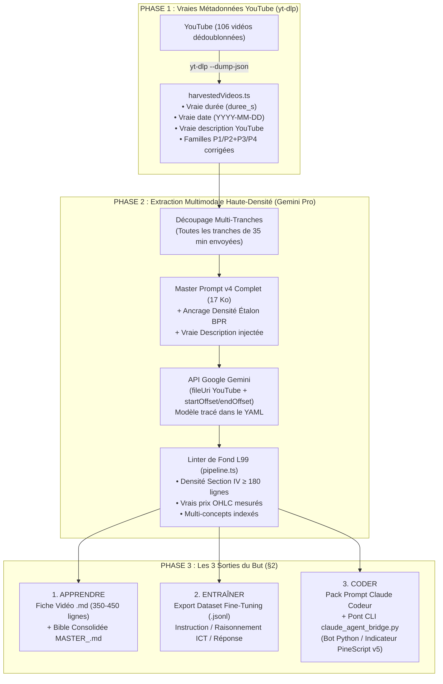

# Plan d'Implémentation v2 (Post-Audit L99) : Réparation de la Qualité des Fiches & Pipeline Hybride (Gemini + Claude)

> [!CAUTION]
> **Constat de l'Audit L99 avant exécution** : Si tes fiches techniques et descriptions actuelles (`XNS2k4KMBhU`, `Fvwb4bJy2N0`, `DOKhK8TFre8` : **143 à 192 lignes / 6 à 9 Ko**) sont superficielles par rapport à ta fiche étalon BPR (**453 lignes / 43 Ko**), ce n'est **pas** un hasard. L'audit du code a révélé **6 bugs structurels** dans le catalogue, le prompt serveur et le linter qui brident Gemini à 30 % de sa capacité et amputent les vidéos à 20 minutes.
> Ce plan corrige **d'abord** ces 6 causes racines (Phases 1 & 2), puis branche la **Consolidation par Concept, le Dataset d'Entraînement et le Pont Claude Codeur** (Phases 3 & 4).

---

## Architecture Cible Complète (Vision §2 Réalisée à 100 %)

---

## Phase 1 : Réparation du Catalogue, du Tri Chronologique et des Descriptions

### Problème prouvé dans le code
Dans [`src/data/harvestedVideos.ts`](file:///C:/Users/CHRIST/.gemini/antigravity/scratch/hugofx-workbench/src/data/harvestedVideos.ts) (et `harvested_videos.json`), **110 vidéos sur 110 (100 %)** ont des valeurs fictives codées en dur :
- `"duree_s": 1200` (20:00 pile) $\rightarrow$ **Ampute toutes les vidéos > 20 min** (ex. `XNS2k4KMBhU` dure `27:08`, mais [`server.ts`](file:///C:/Users/CHRIST/.gemini/antigravity/scratch/hugofx-workbench/server.ts#L68) interdit à Gemini de citer un timestamp au-delà de `20:00` !) et empêche `calculateSlices` de se déclencher sur les vidéos de 2h27.
- `"date_video": "2024-01-01"` $\rightarrow$ **Détruit le tri chronologique** dans [`pipeline.ts`](file:///C:/Users/CHRIST/.gemini/antigravity/scratch/hugofx-workbench/src/utils/pipeline.ts#L89).
- `"description": "Leçon X de la playlist..."` $\rightarrow$ **Description factice d'une ligne** au lieu de la vraie description YouTube d'HugoFX.
- **Inversion des familles** dans [`pipeline.ts`](file:///C:/Users/CHRIST/.gemini/antigravity/scratch/hugofx-workbench/src/utils/pipeline.ts#L67-L70) : `P4` (*Formation Trading Complète Pour Débutant*) est rangée dans `FORMATION_B` au lieu de `FORMATION_2026`, et `P2`/`P3` ne sont pas regroupées en `CONCEPTS_SETUPS`.

### Corrections à apporter
1. **[NOUVEAU] `scripts/repair_catalog_metadata.py`** :
   - Utilise `yt-dlp --dump-json --no-download` sur les 106 URLs uniques pour récupérer sans consommer de quota Gemini :
     - `duration` réelle en secondes (`duree_s`)
     - `upload_date` réelle convertie en `YYYY-MM-DD` (`date_video`)
     - `description` complète YouTube (`description`)
   - Met à jour [`src/data/harvestedVideos.ts`](file:///C:/Users/CHRIST/.gemini/antigravity/scratch/hugofx-workbench/src/data/harvestedVideos.ts) et `harvested_videos.json`.
2. **[MODIFIER] [`src/utils/pipeline.ts`](file:///C:/Users/CHRIST/.gemini/antigravity/scratch/hugofx-workbench/src/utils/pipeline.ts#L50-L98) (`deduplicateVideos`)** :
   - Corriger l'attribution des familles selon ton §2 :
     - `P4` $\rightarrow$ `FORMATION_2026` (Vague 3 : colonne vertébrale)
     - `P1` $\rightarrow$ `FORMATION_A` (Vague 2 : formation détaillée)
     - `P2` + `P3` $\rightarrow$ `CONCEPTS_SETUPS` (Vague 1 : concepts & setups)
   - Ajouter l'ordre de traitement par vague (`vague: 1 | 2 | 3`) et le vrai tri chronologique par `date_video`.

---

## Phase 2 : Restauration du Master Prompt Haute-Densité, Multi-Tranches & Linter de Fond

### Problèmes prouvés dans le code
1. **Prompt serveur amputé et contradictoire** : [`src/data/scribePromptV2.ts`](file:///C:/Users/CHRIST/.gemini/antigravity/scratch/hugofx-workbench/src/data/scribePromptV2.ts) ne fait que **68 lignes** (6,7 Ko) au lieu des **17,6 Ko** du vrai [`PROMPT_SCRIBE_ICT_v3_FINAL.md`](file:///C:/Users/CHRIST/.gemini/antigravity/brain/df17fed7-e096-414a-831e-38c3f037023c/PROMPT_SCRIBE_ICT_v3_FINAL.md). Pire : [`server.ts`](file:///C:/Users/CHRIST/.gemini/antigravity/scratch/hugofx-workbench/server.ts#L87-L125) écrase les consignes de fin avec un squelette ultra-court d'une ligne par section et **omet la Section V**.
2. **Tranche unique > 35 min** : Dans [`server.ts`](file:///C:/Users/CHRIST/.gemini/antigravity/scratch/hugofx-workbench/server.ts#L49), seule `autoSlices[0]` est envoyée (`00:00 - 35:00`). Tout ce qui dépasse 35 minutes est ignoré en silence.
3. **Modèle silencieux & Linter complaisant** : Le modèle réellement utilisé (`gemini-2.5-pro` vs fallback `flash`) n'est pas inscrit dans le YAML, et [`geminiExtractionService.ts`](file:///C:/Users/CHRIST/.gemini/antigravity/scratch/hugofx-workbench/src/services/geminiExtractionService.ts#L243) force `score = 10.0` dès que 4 titres Markdown sont présents.

### Corrections à apporter
1. **[MODIFIER] [`src/data/scribePromptV2.ts`](file:///C:/Users/CHRIST/.gemini/antigravity/scratch/hugofx-workbench/src/data/scribePromptV2.ts)** :
   - Intégrer l'intégralité des exigences chirurgicales de [`PROMPT_SCRIBE_ICT_v3_FINAL.md`](file:///C:/Users/CHRIST/.gemini/antigravity/brain/df17fed7-e096-414a-831e-38c3f037023c/PROMPT_SCRIBE_ICT_v3_FINAL.md) + un **Ancrage de Densité (Few-Shot)** tiré de [`FICHE_ETALON_BPR_v3.md`](file:///C:/Users/CHRIST/.gemini/antigravity/brain/df17fed7-e096-414a-831e-38c3f037023c/FICHE_ETALON_BPR_v3.md) :
     - **Description & Résumé exécutif riches** en tête de fiche (contexte de la vidéo, thèse exacte d'HugoFX, actifs/timeframes montrés à l'écran, liens avec les autres concepts).
     - **Indexation Multi-Concepts dans le YAML** : `concept_principal` + `concepts_enseignes: [FVG, OB, OTE, ...]` avec leurs plages de timestamps respectives (pour qu'une vidéo de 6 concepts comme `XNS2k4KMBhU` alimente les 6 concepts).
     - **Section IV (Leçon Humaine)** : interdiction du style télégraphique ; obligation d'expliquer pas à pas *comment HugoFX détecte l'objet sur son graphique*, *comment il départage un bon d'un mauvais*, *avec quoi il le combine*, et *les pièges mortels*, avec un minimum de **150 lignes uniquement pour la Section IV**.
2. **[MODIFIER] [`server.ts`](file:///C:/Users/CHRIST/.gemini/antigravity/scratch/hugofx-workbench/server.ts)** :
   - Supprimer le bloc contradictoire des lignes 87–125 qui résumait le prompt.
   - Injecter la **vraie durée**, la **vraie date** et la **vraie description YouTube** dans le contexte du prompt.
   - Gérer la **boucle Multi-Tranches** : si une vidéo fait > 35 minutes (`autoSlices.length > 1`), extraire chaque tranche séquentiellement puis fusionner ou numéroter explicitement les tranches (`tranche 1/N`, `2/N`...).
   - Injecter automatiquement `model_used: <vrai_modele_gemini>` et `extracted_at` dans le bloc YAML de la fiche produite, et permettre de bloquer le fallback sur `Flash` (mode **Pro Strict**).
3. **[MODIFIER] [`src/utils/pipeline.ts`](file:///C:/Users/CHRIST/.gemini/antigravity/scratch/hugofx-workbench/src/utils/pipeline.ts#L174-L360) (`lintFicheV3`)** :
   - Remplacer le faux `10/10` par un **Score de Qualité Calculé par le Code (sur 10)** vérifiant :
     1. Présence de vraies valeurs de prix numériques dans le tableau des Exemples (Section I.3).
     2. Longueur et richesse de la Section IV (Leçon Humaine ≥ 3 500 caractères).
     3. Cohérence des timestamps avec la **vraie** `duree_s` de la vidéo.
     4. Présence du bloc JSON `<<<CONCEPT_SPEC_V3>>>` compilable (`JSON.parse` valide sur les parties JSON ou présence complète de `B1` à `B6`).

---

## Phase 3 : Consolidation par Concept & Dataset d'Entraînement JSONL

### Problème prouvé dans le code
Actuellement, chaque vidéo produit un fichier `.md` isolé rangé dans un seul dossier selon son titre. Il est impossible d'avoir **« Tout ce qu'HugoFX enseigne sur le FVG à travers ses 106 vidéos, dans l'ordre chronologique »**, et il n'existe aucun export d'entraînement IA.

### Fichiers à créer
1. **[NOUVEAU] `src/services/conceptConsolidatorService.ts`** :
   - Scanne toutes les fiches `.md` validées.
   - Regroupe les apports par **Concept** (en lisant `concept_principal` ET `concepts_enseignes[]` du YAML, donc `XNS2k4KMBhU` alimente à la fois `SWING`, `LIQUIDITY`, `OTE`, `FVG` et `OB`).
   - Trie les extraits par **vraie date de publication (`date_video`)** croissante.
   - Génère pour chaque concept une **Bible Maîtresse Consolidée (`MASTER_<CONCEPT>.md`)** contenant :
     - Toutes les règles formelles (`R-xx`) et paramètres (`P-xx`) fusionnés.
     - L'évolution chronologique du formateur (*« En déc. 2023 dans XNS2k4KMBhU, HugoFX définit... En mars 2025 dans ..., il ajoute le filtre... »*).
     - Tous les exemples graphiques réels (`E-xx`) et toutes les divergences `DIT ≠ FAIT` (`X-xx`).
     - Le bloc unifié `<<<CONCEPT_SPEC_V3>>>` du concept.
2. **[NOUVEAU] `src/services/trainingDatasetService.ts`** :
   - Génère à partir des fiches validées et consolidées un fichier **`hugofx_training_dataset.jsonl`** prêt pour le Fine-Tuning / RAG :
     - Paires *Apprentissage Conceptuel* (Question sur un concept $\rightarrow$ Réponse sourcée avec critères exacts d'HugoFX).
     - Paires *Audit Graphique & Pièges* (Scénario de marché issu des exemples `E-xx` et contre-exemples $\rightarrow$ Diagnostic `VALIDE` / `INVALIDE` selon les règles `[R-xx]`).
     - Paires *Traduction Algorithmique* (Spécification de règle HugoFX $\rightarrow$ Machine à états `ZONE_FSM` / `TRADE_FSM`).

---

## Phase 4 : Pont Hybride vers Claude Codeur (Option 2)

1. **[NOUVEAU] `src/components/AgentExportModal.tsx`** :
   - Accessible depuis la bibliothèque de fiches et depuis les Bibles Consolidées `MASTER_<CONCEPT>.md`.
   - Permet de choisir la cible :
     - **Indicateur / Stratégie TradingView (`PineScript v5`)**
     - **Bot d'Exécution / Backtester (`Python` + `pandas` / `MetaTrader5` / `ccxt`)**
     - **Audit Quantitatif des Règles & Ambiguïtés (`D-xx`)**
   - Assemble un **Prompt Maître Claude Codeur** qui interdit formellement d'utiliser de l'ICT générique et oblige Claude à implémenter `ZONE_FSM`, `TRADE_FSM`, les seuils `P-xx` et à passer les `FIXTURES` JSON (`E-xx`) de la fiche.
2. **[NOUVEAU] `scripts/claude_agent_bridge.py`** :
   - Script CLI local qui prend une fiche `.md` ou un `MASTER_<CONCEPT>.md`, invoque `claude -p` (ou l'API Anthropic), génère le code dans `generated_bots/<concept>/`, et vérifie automatiquement que les fixtures passent.

---

## Plan de Vérification & Validation (Avant de toucher aux 106 vidéos)

1. **Test Phase 1 (Catalogue)** : Exécuter `repair_catalog_metadata.py` et vérifier que `XNS2k4KMBhU` affiche bien sa vraie durée (`1629s` / `27:09`), sa vraie date (`2023-12-17`) et sa vraie description YouTube (zéro `1200s` ou `2024-01-01` restant).
2. **Test Phase 2 (Qualité Fiche sur 1 vidéo test : `XNS2k4KMBhU`)** :
   - Relancer **uniquement** `XNS2k4KMBhU` avec le nouveau Master Prompt v4 et la vraie durée (`27:09`).
   - Vérifier que la fiche dépasse **300 lignes**, couvre la vidéo jusqu'à **27:00** (incluant enfin les Order Blocks et le modèle d'entrée après 20:00 !), indexe les **6 concepts**, et atteint le niveau de détail de `FICHE_ETALON_BPR_v3.md`.
3. **Test Phases 3 & 4** : Générer la consolidation `MASTER_FVG.md`, le fichier `hugofx_training_dataset.jsonl`, et le pack Claude Codeur sur les fiches existantes.
